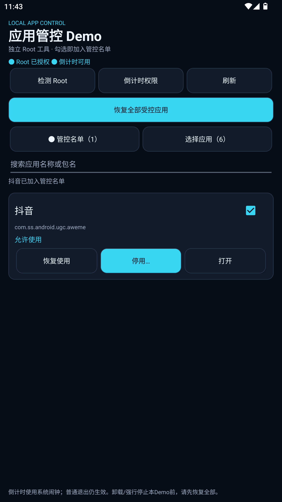
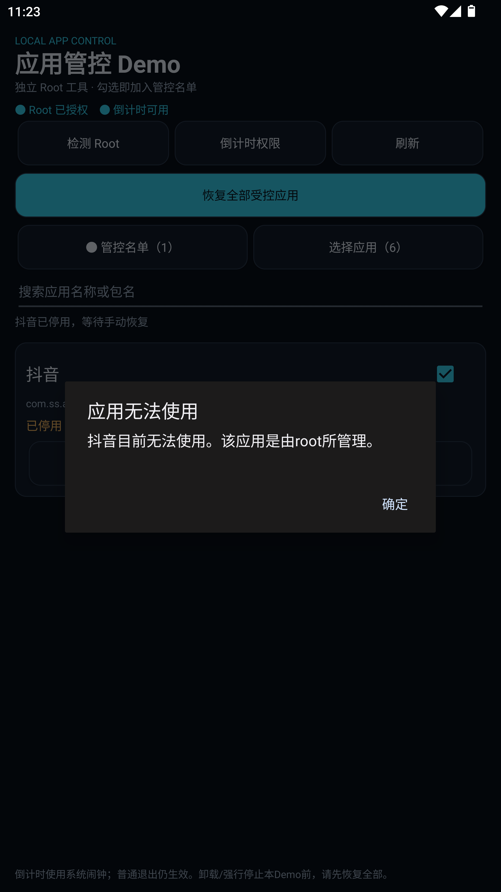

# App Control Demo · 应用管控 Demo

**Root-based Android app control with a selectable app list and automatic countdown recovery.**

**基于 Root 的 Android 应用管控：勾选名单、独立停用／恢复、倒计时自动解除。**

[中文说明](#zh-cn) · [English guide](#en) · [测试验收 / Acceptance](docs/acceptance.md)

| Item / 项目 | Value / 内容 |
| --- | --- |
| Version / 版本 | `1.0.0` · `versionCode 1` |
| Package / 包名 | `com.local.appcontrol.demo` |
| Android | Android 8.0+ · `minSdk 26` |
| SDK | `compileSdk 31` · `targetSdk 31` |
| Build / 构建 | JDK 17 · Gradle Wrapper 7.4.2 · AGP 7.1.0 · Java 11 bytecode |
| UI | Native Android Views / Android 原生界面 |
| Dependencies / 依赖 | No third-party runtime dependencies; JUnit 4 for tests / 无第三方运行时依赖，测试使用 JUnit 4 |

<p>
  
  
</p>

<a id="zh-cn"></a>
## 中文说明

### 1. 项目用途

这是一个独立的 Android Root 应用管控 Demo，可用抖音或其他已安装第三方应用测试“允许使用／暂停使用”。它与“幻境”项目独立，不需要摄像头 Hook、Xposed、LSPosed 或服务端。

操作只针对当前 Android 用户下已勾选的应用，不卸载目标、不清除目标数据。解除暂停后可重新打开目标应用。

### 2. 功能与名单含义

- **应用选择**：读取已安装第三方应用，支持按名称、包名搜索。
- **管控名单**：勾选表示加入管理，勾选本身不会立即停用。
- **独立停用**：每个应用可以分别暂停，并停止其当前进程。
- **独立恢复**：解除本 Demo 记录的暂停；“打开”按钮可随后启动应用。
- **倒计时恢复**：支持秒、分钟、小时，范围为 **1 秒～30 天**；也可选择手动恢复。
- **批量恢复**：一键恢复本 Demo 接管的所有应用。
- **移出名单**：取消勾选前先解除本 Demo 的暂停，恢复失败则保留名单和错误信息。
- **后台恢复**：使用系统精确闹钟、私有恢复记录和续接任务，不依赖页面常驻。

这里按需求将“白名单”实现为**受控应用名单**，并非“勾选后豁免管控”的名单。UI 使用“管控名单”避免混淆。

系统应用、Demo 自身、当前默认桌面、已知 Root 管理器及关键管理组件不能作为管控目标。保护规则见 [`PackagePolicy`](app/src/main/java/com/local/appcontrol/demo/PackagePolicy.java) 和 [`AndroidBackend`](app/src/main/java/com/local/appcontrol/demo/AndroidBackend.java)。隐藏或改包名的 Root 管理器不一定能被识别。

### 3. 运行环境与权限

| 要求 | 说明 |
| --- | --- |
| Android 8.0 或更高 | Android 8/9 通过应用标志读取暂停状态；Android 10+ 使用公开的包暂停查询接口 |
| 可用的 `su` | 需要 Root 管理器**单独授权本 Demo**；仅 ADB 能执行 Root 并不足够 |
| 持久 Root 授权 | 无人点击时后台恢复也需要执行 Root 命令，应在管理器中允许持久授权 |
| 闹钟和提醒 | Android 12+ 倒计时需要精确闹钟权限，应用内可打开对应设置页 |
| ROM 包管理支持 | 系统需支持 Root 执行 `pm suspend` / `pm unsuspend` |

目前实际验证的是 **MuMu Android 12 + Magisk + 抖音 36.4.0**。其他 Root 管理器、ROM、实体手机需要单独验证，不能仅凭安装管理器 APK 就判断 Root 可用。

Manifest 权限用途：

| 权限 | 用途 |
| --- | --- |
| `QUERY_ALL_PACKAGES` | 读取应用清单及包状态，这是应用选择和管控的核心功能 |
| `SCHEDULE_EXACT_ALARM` | 安排用户设置的倒计时恢复 |
| `RECEIVE_BOOT_COMPLETED` | 开机解锁后恢复计时安排 |
| `WAKE_LOCK` | 为广播恢复任务提供短时 CPU 唤醒保护 |

应用没有 `INTERNET` 权限，不上传应用清单，也不需要相机、麦克风或共享存储权限。若计划发布到应用商店，需另外审核广泛包可见性等权限政策；Lint 中的用途说明不等于商店许可。Android 的可见性规则见[官方文档](https://developer.android.com/training/package-visibility/declaring)。

### 4. 安装与首次配置

1. 安装构建出的 APK，打开 **应用管控 Demo**。
2. 点 **检测 Root**，在 Root 管理器弹窗中允许本应用。
3. 若之前拒绝过，在 Root 管理器的“超级用户”页面找到 `com.local.appcontrol.demo`，允许后返回 Demo 再检测。
4. 点 **倒计时权限**。Android 12+ 按提示开启“闹钟和提醒”，返回后状态应显示“倒计时可用”。
5. 点 **选择应用**，搜索“抖音”或包名 `com.ss.android.ugc.aweme`，勾选目标。
6. 回到 **管控名单**，确认目标处于“允许使用”状态。

单设备 ADB 安装示例：

```sh
adb devices
adb install -r app/build/outputs/apk/debug/app-debug.apk
adb shell am start -n com.local.appcontrol.demo/.MainActivity
```

连接多个设备时，请为命令添加 `-s 设备序列号`。MuMu 的 ADB 端口可能随运行实例改变，应以实际设备列表为准。

### 5. 停用、恢复和倒计时

**手动停用：** 在目标卡片点“停用…”→选择“手动恢复”→确认。系统会暂停该应用并结束其当前进程，尝试打开时显示系统的暂停提示。

**倒计时停用：** 点“停用…”→选择“倒计时后恢复”→输入数值和单位→确认。倒计时结束后解除暂停，不会自动启动应用。

**提前恢复：** 点“恢复使用”，或使用“恢复全部受控应用”。重新设置倒计时会替换此前的到期安排，旧闹钟不会提前解除新设置。

**移出名单：** 取消勾选。如果目标仍由本 Demo 暂停，会先尝试恢复，成功后才移出。失败时按错误提示检查 Root，再重试。

Demo 会拒绝接管已经由其他来源暂停的应用。“恢复全部”仅依据本 Demo 保存的归属记录操作，不会扫描并解除所有已安装应用的暂停。这个归属记录不是独立的系统管理身份；多个 Root 工具同时管理同一应用时仍可能发生状态冲突。

### 6. 后台恢复机制与限制

| 场景 | 行为 |
| --- | --- |
| 返回桌面、普通退出页面 | 系统闹钟继续计时 |
| Demo 进程被普通结束／系统回收 | 闹钟可重新启动恢复逻辑；已有实际验证 |
| 同次开机修改系统时间 | 使用单调时钟计算剩余时间，并重新安排闹钟 |
| 重启或更新 Demo | 读取私有记录并重新安排；重启后按保存的墙钟到期时间处理 |
| 设备关机期间到期 | 无法在关机时执行，开机解锁后补处理 |
| Root 恢复失败 | 保留归属和错误信息，过期任务会重试 |
| 强行停止／清除数据／卸载 Demo | 可能取消系统任务或丢失恢复记录，不能保证自动恢复 |
| 撤销 Root 或精确闹钟权限 | 无法保证按时解除，需要恢复权限或手动处理 |

**强行停止、清除数据或卸载 Demo 前，请先点“恢复全部受控应用”。** Root 管理器、系统安全模式或其他特权工具仍能改变状态，本 Demo 不构成不可绕过的安全边界。

实现先保存恢复意图并安排闹钟，再执行暂停。到期广播会先安排续接闹钟，再将工作提交到后台队列；广播最多保持约 8 秒，避免长 Root 操作排队后消耗一次性闹钟却丢失后续恢复机会。系统精确闹钟的权限和行为见[Android 官方说明](https://developer.android.com/develop/background-work/services/alarms)。

### 7. 常见问题与异常恢复

| 问题 | 处理方法 |
| --- | --- |
| `Permission denied`／Root 待检测 | 在 Root 管理器单独允许本 Demo，再点“检测 Root” |
| 找不到某个应用 | 确认它安装在当前 Android 用户中；系统、桌面和受保护应用被过滤 |
| 勾选后还能打开 | 勾选只加入名单，还需点“停用…” |
| 应用已由其他来源暂停 | 到原管理工具恢复；Demo 不会接管已有外部暂停 |
| 倒计时按钮提示缺权限 | 允许“闹钟和提醒”，返回后重新设置倒计时 |
| 已恢复但没有自动打开 | 这是预期行为，点“打开”或从桌面启动 |
| 超时或状态未确认 | 保留恢复记录；检查 Root 后使用“恢复使用”／“恢复全部”重试 |
| 更新提示签名不一致 | 使用原证书重新签名；需要卸载时先恢复全部，再卸载安装 |

优先通过 Demo 恢复。若 Demo 已卸载或记录丢失，可在授权 Root 的 ADB 终端恢复指定包，例如主用户的抖音：

```sh
adb shell su -c 'pm unsuspend --user 0 com.ss.android.ugc.aweme'
```

`0` 是 Android 主用户 ID；工作资料或其他用户应使用实际用户 ID。这个命令不清除应用数据。执行后从桌面重新打开目标。只替换为你明确要恢复的合法包名。

### 8. 从源码构建

需要 Git、JDK 17、Android SDK Platform 31 和可用的 SDK Build Tools。工程使用 Java 11 字节码；JDK 路径通过本机环境配置，不写入项目。

```sh
git clone git@github.com:baby1000001000/app-control-demo.git
cd app-control-demo

# 先将 JAVA_HOME 指向本机 JDK 17，ANDROID_HOME 指向本机 Android SDK。
java -version
printf 'sdk.dir=%s\n' "$ANDROID_HOME" > local.properties
chmod +x gradlew

./gradlew testDebugUnitTest testReleaseUnitTest assembleDebug assembleRelease lintRelease
```

Windows 可用 `gradlew.bat` 执行相同任务，并在 `local.properties` 配置本机 SDK 路径。

| 输出 | 路径 |
| --- | --- |
| Debug APK，开发签名 | `app/build/outputs/apk/debug/app-debug.apk` |
| Release APK，默认未签名 | `app/build/outputs/apk/release/app-release-unsigned.apk` |
| 单元测试报告 | `app/build/reports/tests/testDebugUnitTest/`、`testReleaseUnitTest/` |
| Release Lint 报告 | `app/build/reports/lint-results-release.html` |

`local.properties`、构建缓存、APK、密钥文件都被 Git 忽略。源码不包含签名私钥。

### 9. Release 签名

Release 关闭调试，沿用当前工程的不混淆配置。请使用自己的长期证书签名；Debug 与使用其他证书签名的 APK 不能直接互相覆盖。

假设 Android SDK 的 `zipalign`、`apksigner` 已加入 `PATH`，且已有证书：

```sh
zipalign -f -p 4 \
  app/build/outputs/apk/release/app-release-unsigned.apk \
  app/build/outputs/apk/release/app-release-aligned.apk

apksigner sign \
  --ks /path/to/your-release-key.jks \
  --ks-key-alias your-key-alias \
  --out app-control-demo-release.apk \
  app/build/outputs/apk/release/app-release-aligned.apk

apksigner verify --verbose --print-certs app-control-demo-release.apk
zipalign -c -p 4 app-control-demo-release.apk
```

`apksigner` 会按需提示输入证书密码，避免把密码写进源码或脚本。必须先对齐、再签名；签名后修改 APK 会使签名失效，见[官方签名工具说明](https://developer.android.com/tools/apksigner)。此前本地验收包沿用开发证书，不能把它视为独立的正式发布证书。

### 10. 模块结构、数据与安全边界

| 模块 | 职责 |
| --- | --- |
| `ControlManager` | 选择名单、暂停归属、持久化与调度顺序、恢复、失败重试 |
| `Rule` / `TimePoint` | 不可变状态、单调／墙钟计时及跨开机重建 |
| `PackagePolicy` | 包名格式校验、固定关键包保护 |
| `AndroidBackend` / `RootCommander` | 当前用户包状态、Root 命令、执行超时、真实状态复核 |
| `RuleStore` | 私有 `AtomicFile`，保存 `files/control-rules.json` |
| `RecoveryAlarm` | 单个最早到期的系统闹钟及续接闹钟 |
| `RecoveryLease` / `ReceiverWork` | 广播完成期限、唤醒保护、排队恢复 |
| `AppEngine` | 串行后台执行器、非 UI 线程包清单读取、UI 观察者 |
| `MainActivity` | 原生应用列表、搜索、选择、操作、倒计时界面 |

数据保存在本应用私有目录，包含包名、是否由 Demo 接管、到期时间、开机计数和错误信息。恢复记录不参与云备份或设备迁移，避免把一台设备的状态带到另一台设备。

包名在执行前严格校验；命令只由固定操作构造；控制按当前 Android 用户执行；闹钟使用显式、不可变 `PendingIntent`；恢复 Receiver 不导出。支持系统开机／更新时间事件的 Receiver 仅接受相应系统事件。

### 11. 验证范围

Debug 和 Release 各 **15 项单元测试**通过，Release Lint **0 错误、2 项兼容属性提示**。测试覆盖未选中隔离、写盘／闹钟／Root 失败、外部暂停拒绝、重新计时、取消勾选恢复、进程重建、跨开机、系统时间变化、广播排队超时和参数校验。

MuMu 上实际验证了抖音：系统暂停拦截、手动恢复、20 秒倒计时、取消勾选恢复；60 秒测试在剩余约 59 秒时结束 Demo 进程，随后仍按时解除暂停并可重新打开。目标数据身份保持不变，未清除／卸载。

**实体手机、实际重启及其他 ROM 未计为实测通过。** 相关状态逻辑有单元测试，完整记录见[测试验收](docs/acceptance.md)。

<a id="en"></a>
## English guide

### 1. Purpose

App Control Demo is a standalone native Android utility for allowing or suspending selected third-party apps, including Douyin. It is independent of the Huanjing camera project and needs no camera hooks, Xposed, LSPosed, or server.

Operations apply to selected packages in the current Android user. The demo does not uninstall targets or clear their data. After suspension is removed, the target can be opened again.

### 2. Features and list semantics

- Discover installed third-party apps and search by label or package name.
- Check apps to add them to the **managed-app list**. Selection alone does not suspend them.
- Suspend an individual app and force-stop its current process.
- Restore access individually, then launch the app with the separate Open button.
- Set a countdown in seconds, minutes, or hours, from **1 second to 30 days**, or require manual restoration.
- Restore all suspensions owned by this demo.
- Restore an app before removing it from the managed list; retain the entry and error if restoration fails.
- Recover through system alarms and a private ledger without keeping the activity visible.

The requested “whitelist” means **apps selected for management**, not apps exempt from restrictions. The UI calls it a managed list to make this distinction explicit.

The demo excludes itself, system apps, the current default launcher, known Root managers, and protected management components. See [`PackagePolicy`](app/src/main/java/com/local/appcontrol/demo/PackagePolicy.java) and [`AndroidBackend`](app/src/main/java/com/local/appcontrol/demo/AndroidBackend.java). A hidden or repackaged Root manager may not be recognized.

### 3. Requirements and permissions

| Requirement | Details |
| --- | --- |
| Android 8.0+ | Android 8/9 reads the suspended application flag; Android 10+ uses the public package suspension query |
| Working `su` | The Root manager must authorize **this demo separately**; Root access from ADB alone is insufficient |
| Persistent Root approval | Background recovery must be able to execute without an interactive prompt |
| Alarms & reminders | Android 12+ countdowns require exact-alarm access; the app opens the relevant settings screen |
| ROM package-manager support | Root must be able to execute `pm suspend` and `pm unsuspend` |

The tested environment is **MuMu Android 12 + Magisk + Douyin 36.4.0**. Other Root managers, ROMs, and physical phones require their own verification. Installing a Root manager APK does not establish working Root access.

| Manifest permission | Purpose |
| --- | --- |
| `QUERY_ALL_PACKAGES` | App inventory and package-state inspection, required for this tool’s central management workflow |
| `SCHEDULE_EXACT_ALARM` | User-requested countdown recovery |
| `RECEIVE_BOOT_COMPLETED` | Reschedule recovery after boot and user unlock |
| `WAKE_LOCK` | Brief CPU protection while dispatching recovery work |

There is no `INTERNET` permission, app-list upload, or camera, microphone, or shared-storage requirement. Store distribution requires a separate permission-policy review; a Lint rationale is not store approval. See Android’s [package visibility documentation](https://developer.android.com/training/package-visibility/declaring).

### 4. Install and configure

1. Install a built APK and open **应用管控 Demo / App Control Demo**.
2. Tap **检测 Root / Check Root**, then approve the request in your Root manager.
3. If previously denied, enable `com.local.appcontrol.demo` on the manager’s Superuser page and check again.
4. Tap **倒计时权限 / Countdown permission**. On Android 12+, allow Alarms & reminders and return to the app.
5. Open **选择应用 / Select apps**, find Douyin or `com.ss.android.ugc.aweme`, and check it.
6. Return to **管控名单 / Managed list**. The app should initially be allowed for use.

For one connected device:

```sh
adb devices
adb install -r app/build/outputs/apk/debug/app-debug.apk
adb shell am start -n com.local.appcontrol.demo/.MainActivity
```

With multiple devices, add `-s DEVICE_SERIAL`. MuMu’s ADB port can change between running instances; inspect the actual device list.

The current app UI is Chinese. This bilingual README explains the corresponding controls; an English UI localization is not implemented.

### 5. Suspend, restore, and set a timer

**Manual suspension:** Select Suspend, choose Manual restoration, and confirm. Android suspends the package and its running process is stopped. A launch attempt shows the system suspension screen.

**Timed suspension:** Select countdown restoration, enter the amount and unit, and confirm. Expiration restores access without automatically launching the target.

**Restore early:** Use Restore access or Restore all managed apps. Setting a new countdown replaces the previous deadline; a stale alarm does not release a newer suspension early.

**Remove an entry:** Uncheck it. An owned suspension is removed before the entry is deleted. If restoration fails, check Root access and retry.

The demo refuses to take over an app already suspended by another source. Restore all acts on its private ownership ledger rather than every suspended package on the device. This ledger is not a separate system administrator identity: other Root tools managing the same package may still conflict with it.

### 6. Background recovery and limits

| Situation | Expected behavior |
| --- | --- |
| Leave the screen or return Home | The system alarm remains scheduled |
| Ordinary process termination or reclamation | The alarm can restart recovery; verified on MuMu |
| Change the clock within one boot | Monotonic remaining time is retained and the alarm is rescheduled |
| Reboot or update the demo | Reload the ledger and reschedule; after reboot use the saved wall-clock deadline |
| Deadline passes while powered off | Recovery can only run after boot and user unlock |
| Root restoration fails | Retain ownership and error information; retry overdue work |
| Force-stop, clear data, or uninstall the demo | System work or recovery records may be lost; automatic recovery is not guaranteed |
| Revoke Root or exact-alarm access | Timely recovery is not guaranteed; restore permissions or recover manually |

**Restore all managed apps before force-stopping, clearing data, or uninstalling the demo.** Root managers, safe mode, and other privileged tools can alter state. This is not an unbypassable security boundary.

The implementation saves recovery intent and schedules its alarm before suspending a target. A recovery broadcast arms a continuation alarm before queueing work, and its broadcast lease is limited to approximately eight seconds. This avoids consuming a one-shot alarm while long Root operations prevent recovery from running. See the [official alarm guide](https://developer.android.com/develop/background-work/services/alarms) for platform permissions and behavior.

### 7. Troubleshooting and emergency recovery

| Symptom | Action |
| --- | --- |
| Permission denied / Root unchecked | Authorize this package in the Root manager, then check again |
| An app is missing | Check the Android user; system, launcher, and protected packages are filtered |
| A checked app still opens | Checking only selects management; explicitly suspend it |
| App already suspended elsewhere | Restore it through the original tool; the demo will not take over |
| Countdown permission missing | Allow Alarms & reminders and configure the timer again |
| Restored app does not launch by itself | Expected: use Open or launch from the home screen |
| Timeout or unconfirmed system state | Recovery intent is retained; verify Root and retry Restore access / Restore all |
| Signature mismatch during an update | Sign with the original certificate; restore all before any uninstall required to change certificates |

Prefer recovery through the app. If it has been removed or its ledger was lost, an authorized Root ADB session can restore a specific package, for example Douyin in the primary user:

```sh
adb shell su -c 'pm unsuspend --user 0 com.ss.android.ugc.aweme'
```

`0` is the primary Android user ID. Substitute the correct user ID for another user or work profile. This does not clear app data. Launch the target again afterward, and only substitute a package you explicitly intend to restore.

### 8. Build from source

Install Git, JDK 17, Android SDK Platform 31, and SDK Build Tools. Java 11 bytecode is used. Configure the JDK through your environment instead of committing a machine-specific JDK path.

```sh
git clone git@github.com:baby1000001000/app-control-demo.git
cd app-control-demo

# Set JAVA_HOME to JDK 17 and ANDROID_HOME to your local Android SDK first.
java -version
printf 'sdk.dir=%s\n' "$ANDROID_HOME" > local.properties
chmod +x gradlew

./gradlew testDebugUnitTest testReleaseUnitTest assembleDebug assembleRelease lintRelease
```

On Windows, run the same tasks with `gradlew.bat` and configure the SDK location in `local.properties`.

| Output | Location |
| --- | --- |
| Development-signed Debug APK | `app/build/outputs/apk/debug/app-debug.apk` |
| Unsigned Release APK | `app/build/outputs/apk/release/app-release-unsigned.apk` |
| Unit-test reports | `app/build/reports/tests/testDebugUnitTest/` and `testReleaseUnitTest/` |
| Release Lint report | `app/build/reports/lint-results-release.html` |

Local SDK settings, build caches, APKs, and keystores are ignored by Git. No signing private key is included.

### 9. Sign a Release APK

Release builds disable debugging and retain the project’s non-minified configuration. Use your own long-term certificate. APKs signed with different certificates cannot directly update each other.

With SDK `zipalign` and `apksigner` on `PATH`, and an existing keystore:

```sh
zipalign -f -p 4 \
  app/build/outputs/apk/release/app-release-unsigned.apk \
  app/build/outputs/apk/release/app-release-aligned.apk

apksigner sign \
  --ks /path/to/your-release-key.jks \
  --ks-key-alias your-key-alias \
  --out app-control-demo-release.apk \
  app/build/outputs/apk/release/app-release-aligned.apk

apksigner verify --verbose --print-certs app-control-demo-release.apk
zipalign -c -p 4 app-control-demo-release.apk
```

Let the tool prompt for passwords rather than committing them to scripts. Align before signing; modifying a signed APK invalidates its signature. See the [official signing-tool documentation](https://developer.android.com/tools/apksigner). The local acceptance APK used the development certificate, not a dedicated production certificate.

### 10. Architecture, data, and boundaries

| Module | Responsibility |
| --- | --- |
| `ControlManager` | Selection, ownership, transaction ordering, recovery, and failure retries |
| `Rule` / `TimePoint` | Immutable state and monotonic/wall-clock deadlines across process and boot changes |
| `PackagePolicy` | Package-name validation and fixed protected identities |
| `AndroidBackend` / `RootCommander` | Current-user package state, bounded Root execution, and post-operation verification |
| `RuleStore` | Private atomic ledger at `files/control-rules.json` |
| `RecoveryAlarm` | Earliest user deadline and continuation alarm |
| `RecoveryLease` / `ReceiverWork` | Broadcast lifetime, wake protection, and queued recovery |
| `AppEngine` | Serial background operations, off-main-thread inventory, and UI observers |
| `MainActivity` | Native searchable list, selection, actions, and timer dialog |

The private ledger contains package names, ownership, deadlines, boot count, and errors. Recovery state is excluded from cloud backup and device transfer to avoid carrying one device’s ownership into another.

Package arguments are validated before fixed Root commands are constructed. Operations target the current Android user. Alarm PendingIntents are explicit and immutable. The recovery receiver is not exported; lifecycle receivers accept the corresponding system events.

### 11. Verification scope

Both Debug and Release pass **15 unit tests each**. Release Lint reports **zero errors and two compatibility-attribute notices**. Coverage includes unselected-package isolation, storage/alarm/Root failures, external suspension rejection, timer replacement, deselection recovery, process recreation, reboot/clock calculations, queued broadcast completion, and argument validation.

Real MuMu tests cover system-blocked Douyin launches, manual recovery, a 20-second countdown, and deselection recovery. During a 60-second countdown, the demo process was terminated with approximately 59 seconds remaining; Android subsequently restored access and Douyin could launch again. Target data identity was preserved.

**Physical phones, an actual reboot, and other ROMs have not been counted as verified.** Their state transitions have unit coverage where applicable. See the [acceptance record](docs/acceptance.md) for the exact evidence and limits.
